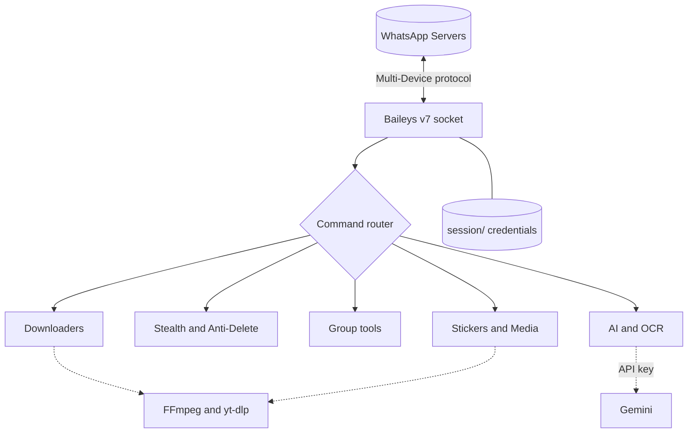

<a name="top"></a>

<div align="center">


<a href="https://github.com/themalik-g/al-jin-whatsapp-bot">
  
</a>

<br/>

[](https://github.com/themalik-g/al-jin-whatsapp-bot/releases)
[](LICENSE)
[](https://nodejs.org)
[](https://github.com/WhiskeySockets/Baileys)
[](https://aistudio.google.com)

[](https://github.com/themalik-g/al-jin-whatsapp-bot/stargazers)
[](https://github.com/themalik-g/al-jin-whatsapp-bot/network/members)
[](https://github.com/themalik-g/al-jin-whatsapp-bot/issues)
[](https://github.com/themalik-g/al-jin-whatsapp-bot/commits)
[](https://github.com/themalik-g/al-jin-whatsapp-bot)
[](#top)

<br/>

**[Quick Start](#quick-start)** &nbsp;•&nbsp;
**[Features](#features)** &nbsp;•&nbsp;
**[Configuration](#configuration)** &nbsp;•&nbsp;
**[Deploy](#deployment)** &nbsp;•&nbsp;
**[Commands](#commands)** &nbsp;•&nbsp;
**[FAQ](#faq)**

</div>


## About

**Al-Jin** is a free, open-source, **self-hosted WhatsApp Multi-Device bot** for Node.js, built on [Baileys v7](https://github.com/WhiskeySockets/Baileys). It links to your account through **Linked Devices** with an 8-character pairing code (no QR scan), runs on your own machine or server, and ships with **300+ commands**: media downloaders, AI chat, stickers, group moderation, message recovery, and more.

> [!IMPORTANT]
> Al-Jin is an unofficial project and is not affiliated with or endorsed by WhatsApp or Meta. Automating a personal account can violate WhatsApp's Terms of Service and may lead to restrictions. Use it on accounts you can afford to risk, and only with the consent of the people you chat with.

<div align="center">

| 🛡️ Anti-Delete | 👁️ View-Once Saver | 📸 Status Saver | 🤖 Gemini AI |
|:---:|:---:|:---:|:---:|
| Recover deleted and edited messages | Keep view-once media you receive | Save contacts' statuses | Free AI chat in any chat |

| ⬇️ Downloaders | 🎭 Stickers | 👥 Group Tools | 🎬 Movies |
|:---:|:---:|:---:|:---:|
| YouTube, IG, TikTok, FB, X and more | Create and convert | Moderation and protection | Search and info |

</div>

---

<a name="quick-start"></a>
## Quick Start

Pick your platform. Every launcher installs dependencies and starts the bot for you.

<table align="center">
<tr><td align="center" width="130"><b>🪟 Windows</b></td><td>Download <code>Al-Jin-Start.bat</code> and double-click it</td></tr>
<tr><td align="center"><b>🍎 macOS</b></td><td>Double-click <code>Al-Jin-Start.command</code></td></tr>
<tr><td align="center"><b>🐧 Linux</b></td><td><code>bash aljin.sh</code></td></tr>
<tr><td align="center"><b>📱 Android</b></td><td>See the <a href="#termux-android">Termux guide</a> below</td></tr>
<tr><td align="center"><b>🐳 Docker</b></td><td>See <a href="#deployment">Deployment</a></td></tr>
</table>

**First run in four steps**


> [!TIP]
> Use your number in international format without `+` or spaces, for example `923001234567`.

---

<a name="features"></a>
## Features

<details open>
<summary><b>🕶️ Stealth Mode (enabled by default)</b></summary>

<br/>

- No "online" presence broadcast
- No read receipts (blue ticks)
- No "typing..." indicator
- No automatic reactions to statuses

Toggle with `STEALTH_MODE` in your `.env`.

</details>

<details>
<summary><b>🛡️ Anti-Delete and Anti-Edit</b></summary>

<br/>

- Shows what a sender removed or changed
- Handles text, images, video, documents and voice notes
- Optional logging to a private chat of your choice

</details>

<details>
<summary><b>👁️ View-Once and Status Saver</b></summary>

<br/>

- Stores view-once photos and videos you receive so you can open them again
- Downloads contacts' status updates on request
- Everything is saved locally on your own device

</details>

<details>
<summary><b>⬇️ Universal Downloader</b></summary>

<br/>

| Platform | Content |
|----------|---------|
| YouTube | Video, audio, Shorts |
| Instagram | Reels, posts, stories |
| TikTok | Video without watermark |
| Facebook | Public videos |
| X (Twitter) | Videos and GIFs |
| Pinterest | Images and videos |
| MediaFire | Direct files |
| Spotify | Audio via yt-dlp |

Available quality depends on the source and your server's bandwidth.

</details>

<details>
<summary><b>🤖 AI and Productivity</b></summary>

<br/>

- **Gemini chat** in any conversation (free API key)
- **PowerPoint maker**: generate a `.pptx` from a text prompt
- **Subtitle generator** for videos
- **OCR** with Tesseract.js
- **QR and barcode** generators

</details>

<details>
<summary><b>👥 Group Management</b></summary>

<br/>

- Auto-moderation: spam, links, banned words
- Welcome and goodbye messages
- Anti-bot and anti-raid protection
- Kick, ban, mute, promote, demote
- Member and activity analytics

</details>

<details>
<summary><b>🎭 Stickers and Media</b></summary>

<br/>

- Photo to sticker (crop, rounded, circle)
- Video or GIF to animated sticker
- Text to sticker with custom fonts and colors
- Sticker back to photo, plus audio and video converters

</details>

---

## Architecture



---

## Tech Stack

<div align="center">


</div>

---

## Project Structure

```text
al-jin-whatsapp-bot/
├── start.js                 # Entry point
├── commands/                # Command modules, grouped by category
│   ├── downloader/
│   ├── group/
│   ├── ai/
│   ├── sticker/
│   ├── stealth/
│   └── utility/
├── lib/                     # Core Baileys connection
├── scripts/                 # Auto-patch and setup helpers
├── session/                 # Auth credentials (auto-generated, never commit)
├── aljin.sh                 # Linux/macOS installer
├── Al-Jin-Start.bat         # Windows launcher
├── Al-Jin-Start.command     # macOS launcher
├── ecosystem.config.cjs     # PM2 production config
└── package.json
```

> [!CAUTION]
> The `session/` folder holds your WhatsApp login. Keep it out of Git (add it to `.gitignore`) and never share it.

---

<a name="configuration"></a>
## Configuration

Create a `.env` file in the project root:

```env
# Required
OWNER_NUMBER=923001234567      # Country code, no "+"

# Optional: AI
GEMINI_API_KEY=your_key_here   # Free at https://aistudio.google.com

# Optional: behavior
BOT_NAME=Al-Jin
PREFIX=.
STEALTH_MODE=true
ANTI_DELETE=true
VIEW_ONCE_REVEAL=true
```

---

<a name="deployment"></a>
## Deployment

**Requirements:** Node.js 20 or newer (`node -v`), FFmpeg, Git.

### VPS or local machine with PM2 (recommended)

```bash
git clone https://github.com/themalik-g/al-jin-whatsapp-bot.git
cd al-jin-whatsapp-bot
npm install
npm run pm2:start     # start with auto-restart
npm run pm2:logs      # follow logs
npm run pm2:restart   # restart
```

### Docker

```bash
docker build -t al-jin .
docker run -d --name aljin --restart unless-stopped \
  -v "$(pwd)/session:/app/session" \
  --env-file .env \
  al-jin
```

Mounting `session/` keeps you logged in across container restarts.

<a name="termux-android"></a>
### Termux (Android)

```bash
pkg update && pkg upgrade -y
pkg install -y nodejs git ffmpeg
git clone https://github.com/themalik-g/al-jin-whatsapp-bot.git
cd al-jin-whatsapp-bot
npm install
npm start
```

Prefer the one-liner? `pkg install -y curl && curl -fsSL -o aljin.sh https://raw.githubusercontent.com/themalik-g/al-jin-whatsapp-bot/main/aljin.sh && bash aljin.sh`

---

<a name="commands"></a>
## Commands

Send `.menu` in any chat for the full list. Default prefix is `.` (change it with `PREFIX`).

| Category | Examples |
|----------|----------|
| ⬇️ Downloader | `.yt` `.ig` `.tiktok` `.fb` `.twitter` |
| 🕶️ Stealth | `.antidelete on` `.viewonce` `.statussave` |
| 🤖 AI | `.ai` `.gpt` `.ocr` `.subtitle` `.pptx` |
| 🎭 Stickers | `.sticker` `.attp` `.ttp` `.circle` |
| 👥 Group | `.kick` `.promote` `.mute` `.antilink` |
| 🎞️ Media | `.toimg` `.tomp3` `.compress` `.gif` |
| 🎉 Fun | `.meme` `.quote` `.fact` `.joke` |
| 🧰 Utility | `.qr` `.barcode` `.translate` `.weather` |
| 👑 Owner | `.broadcast` `.setvar` `.restart` |
| 🎬 Movies | `.movie` `.series` `.searchmovie` |

---

## Why Al-Jin

| | Al-Jin | Typical cloud bot | Other self-hosted bots |
|---|:---:|:---:|:---:|
| Price | Free | Monthly fee | Free |
| Data location | Your device | Provider's cloud | Your device |
| Anti-delete | Built in | Often paid | Varies |
| View-once saver | Built in | Rare | Varies |
| Free AI chat | Gemini | Limited | Varies |
| One-click setup | Yes | n/a | Usually manual |
| Stealth by default | Yes | No | Varies |

---

<a name="faq"></a>
## FAQ

<details>
<summary><b>Is Al-Jin free?</b></summary>

<br/>

Yes. It is open source under the MIT License with no paid tiers. Optional services you connect yourself (such as a Gemini API key) follow their own pricing.

</details>

<details>
<summary><b>Is it safe? Can my number get banned?</b></summary>

<br/>

Your data stays on your own device. However, Al-Jin is an unofficial client, and WhatsApp can restrict accounts that use automation. Avoid bulk messaging or spam, and consider a secondary number.

</details>

<details>
<summary><b>Does it work with WhatsApp Business?</b></summary>

<br/>

Yes, through Linked Devices on both WhatsApp Messenger and WhatsApp Business.

</details>

<details>
<summary><b>Can I run more than one bot?</b></summary>

<br/>

Yes. Clone the repo into separate folders and give each its own `OWNER_NUMBER` and `session/`.

</details>

<details>
<summary><b>Which Node.js version do I need?</b></summary>

<br/>

Node.js 20 or newer. Check with `node -v` and upgrade at [nodejs.org](https://nodejs.org).

</details>

<details>
<summary><b>The pairing code does not work. What now?</b></summary>

<br/>

Delete the `session/` folder, restart, and request a fresh code. Make sure the number is in international format without `+`, and that you enter the code under Linked Devices > Link with phone number.

</details>

---

## Star History

<div align="center">

<a href="https://star-history.com/#themalik-g/al-jin-whatsapp-bot&Date">
  <picture>
    <source media="(prefers-color-scheme: dark)" srcset="https://api.star-history.com/svg?repos=themalik-g/al-jin-whatsapp-bot&type=Date&theme=dark"/>
    <source media="(prefers-color-scheme: light)" srcset="https://api.star-history.com/svg?repos=themalik-g/al-jin-whatsapp-bot&type=Date"/>
    
  </picture>
</a>

</div>

---

## Contributing

1. Fork the repository
2. Create a branch: `git checkout -b feature/your-feature`
3. Commit: `git commit -m "Add your feature"`
4. Push: `git push origin feature/your-feature`
5. Open a Pull Request

<a href="https://github.com/themalik-g/al-jin-whatsapp-bot/graphs/contributors">
  
</a>

**Support:** [open a bug report](https://github.com/themalik-g/al-jin-whatsapp-bot/issues/new?labels=bug) or [request a feature](https://github.com/themalik-g/al-jin-whatsapp-bot/issues/new?labels=enhancement). For direct help, message **@insaf.pk** on WhatsApp with a screenshot of the error.

---

## License

Released under the [MIT License](LICENSE). Copyright (c) 2024 Malik Mehtab.

## Acknowledgments

[Baileys](https://github.com/WhiskeySockets/Baileys) • [Google Gemini](https://deepmind.google/technologies/gemini/) • [ytdlp-nodejs](https://github.com/depresio/ytdlp-nodejs) • [FFmpeg](https://ffmpeg.org/)

<div align="center">


**Built by [Malik Mehtab](https://github.com/themalik-g)** &nbsp;|&nbsp; [⬆ Back to top](#top)

</div>
