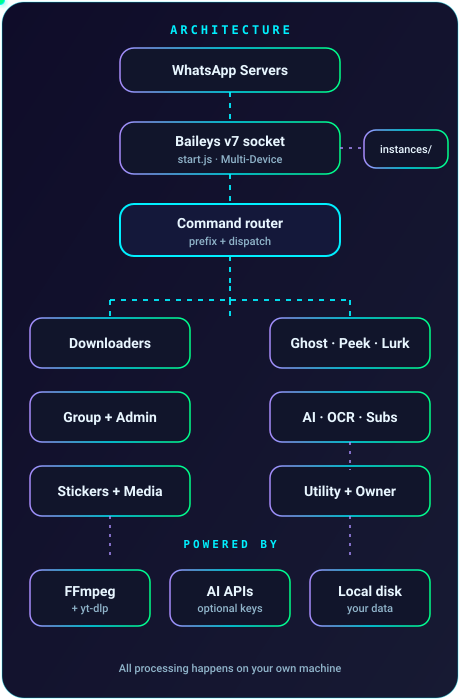
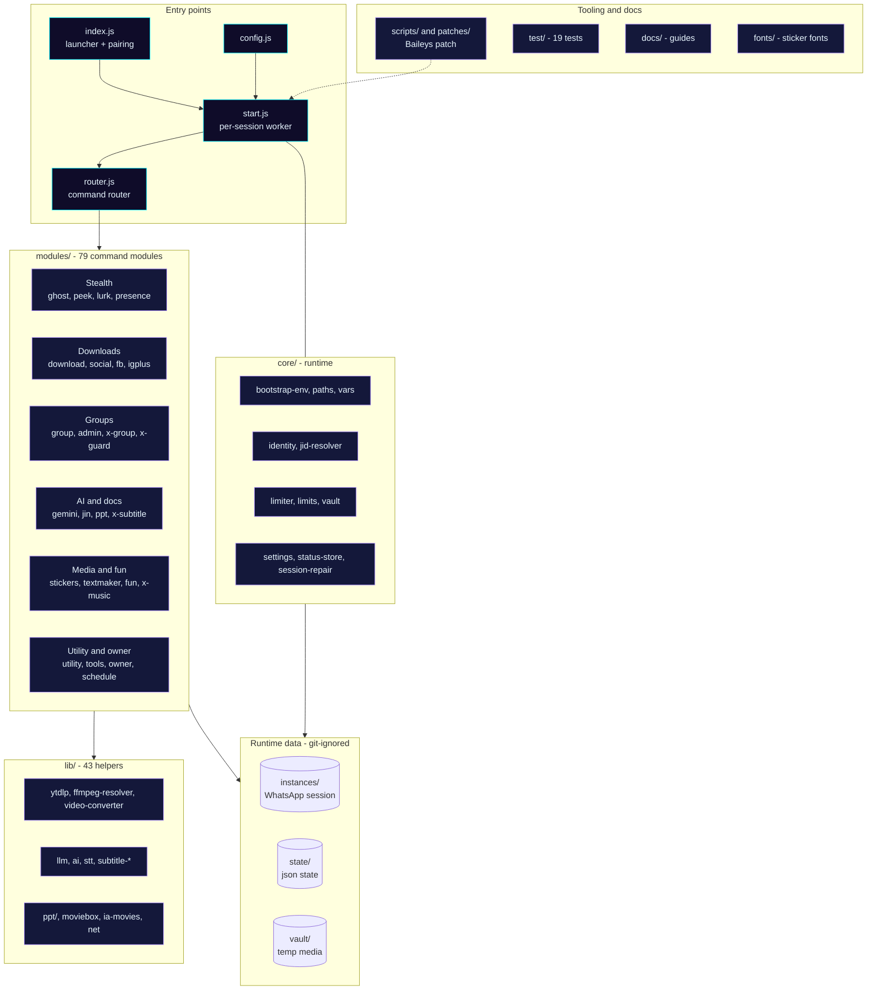

<a name="top"></a>

<div align="center">


<a href="https://github.com/themalik-g/al-jin-whatsapp-bot">
  
</a>

<br/>


<br/><br/>

[](#user-manual)
[](docs/README.md)
[](docs/support.md)

<br/>

[](https://github.com/themalik-g/al-jin-whatsapp-bot/releases)
[](LICENSE)
[](https://nodejs.org)
[](https://github.com/WhiskeySockets/Baileys)
[](docs/settings-and-keys.md)

[](https://github.com/themalik-g/al-jin-whatsapp-bot/stargazers)
[](https://github.com/themalik-g/al-jin-whatsapp-bot/network/members)
[](https://github.com/themalik-g/al-jin-whatsapp-bot/issues)
[](https://github.com/themalik-g/al-jin-whatsapp-bot/commits)
[](https://github.com/themalik-g/al-jin-whatsapp-bot)
[](https://github.com/themalik-g/al-jin-whatsapp-bot/watchers)
[](https://hits.sh/github.com/themalik-g/al-jin-whatsapp-bot/)

<br/>

**[Quick Start](#quick-start)** &nbsp;•&nbsp;
**[Features](#features)** &nbsp;•&nbsp;
**[Structure](#project-structure)** &nbsp;•&nbsp;
**[Configuration](#configuration)** &nbsp;•&nbsp;
**[Deploy](#deployment)** &nbsp;•&nbsp;
**[Commands](#commands)** &nbsp;•&nbsp;
**[Manual](#user-manual)** &nbsp;•&nbsp;
**[Docs](#documentation)** &nbsp;•&nbsp;
**[FAQ](#faq)**

</div>

<div align="center"></div>

## About

**Al-Jin** is a free, open-source, **self-hosted WhatsApp Multi-Device bot** for Node.js 20+, built on [Baileys v7](https://github.com/WhiskeySockets/Baileys). It links to your account through **Linked Devices** with an 8-character pairing code (no QR scan), runs on your own machine or server, and ships with **300+ commands**: media downloaders, free AI chat, stickers, group moderation, message recovery, movies, Islamic tools, and more.

<div align="center">


</div>

> [!IMPORTANT]
> Al-Jin is an unofficial project and is not affiliated with or endorsed by WhatsApp or Meta. Automating a personal account can violate WhatsApp's Terms of Service and may lead to restrictions. Use it on accounts you can afford to risk, and only with the consent of the people you chat with.

<div align="center">

| 🛡️ Ghost | 👁️ Peek | 📸 Lurk | 🤖 Free AI |
|:---:|:---:|:---:|:---:|
| Recover deleted and edited messages | Keep view-once media you receive | Watch and save statuses silently | Chat with AI, no key needed |

| ⬇️ Downloaders | 🎭 Stickers | 👥 Group Tools | 🎬 Movies |
|:---:|:---:|:---:|:---:|
| YouTube, IG, TikTok, FB, X and more | Create and convert | Moderation and protection | Search and download |

</div>

<div align="center"></div>

<a name="quick-start"></a>
## Quick Start

Pick your platform. Every launcher installs what it needs and starts the bot for you. No prior Node.js, npm or git install is required.

<table align="center">
<tr><td align="center" width="130"><b>🪟 Windows</b></td><td>Download <code>Al-Jin-Start.bat</code> and double-click it</td></tr>
<tr><td align="center"><b>🍎 macOS</b></td><td>Double-click <code>Al-Jin-Start.command</code></td></tr>
<tr><td align="center"><b>🐧 Linux</b></td><td><code>bash aljin.sh</code></td></tr>
<tr><td align="center"><b>📱 Android</b></td><td>See the <a href="#termux-android">Termux guide</a> below</td></tr>
<tr><td align="center"><b>🐳 Docker</b></td><td>See <a href="#deployment">Deployment</a></td></tr>
</table>

**First run in five steps**

<br/>

<div align="center">
  
</div>

<br/>

<div align="center">
  
</div>

<br/>

> [!TIP]
> Use your number in international format without `+` or spaces, for example `923001234567`. You can also pass it directly: `node index.js --phone=923001234567`.

Full walkthroughs with screenshots-free, step-by-step wording: [One-click start](docs/one-click-deploy.md) · [Manual install](docs/manual-install.md).

<div align="center"></div>

<a name="user-manual"></a>
## User Manual

New to Al-Jin? Read the official manual first. It walks through setup, pairing and every command group in plain language.

<div align="center">

| 📖 Read online | 📲 Get it in WhatsApp | 📚 Browse the guides |
|:---:|:---:|:---:|
| [**Open the PDF manual**](https://github.com/themalik-g/wraith_manual/blob/main/wraith_manual.pdf) | Send **`.usermanual`** to the bot and it replies with `Al-Jin_Manual.pdf` | [**docs/**](docs/README.md): install, stealth, keys, troubleshooting |

</div>

> [!TIP]
> Already linked? Send `.menu` for the command list or `.usermanual` for the full PDF, right inside WhatsApp.

<div align="center"></div>

<a name="features"></a>
## Features

<details open>
<summary><b>🕶️ Stealth Mode (default)</b></summary>

<br/>

Out of the box the bot stays quiet. Each of these is **off** until you switch it on:

| Behaviour | Default | Turn it on |
|---|:---:|---|
| Shows "online" | off | `.presence online on` |
| Marks statuses as seen | off | `.lurk on` |
| Reacts to statuses | off | `.lurk react on` |
| Read receipts (blue ticks) | off | `.presence reads on` |
| Typing or recording indicator | off | `.presence typing on` / `.presence recording on` |
| Saves statuses silently | **on** | `.lurk download off` to stop |

WhatsApp decides what contacts finally see. If you open WhatsApp on your own phone, that phone shows you online. Details: [docs/stealth.md](docs/stealth.md).

</details>

<details>
<summary><b>🛡️ Ghost: Anti-Delete and Anti-Edit</b></summary>

<br/>

- Shows what a sender removed or changed
- Handles text, images, video, documents and voice notes
- Commands: `.ghost on|off` and `.ghost edit on|off`

</details>

<details>
<summary><b>👁️ Peek: View-Once Saver</b></summary>

<br/>

- Stores view-once photos and videos you receive so you can open them again
- `.peek`, `.peek auto` (forward automatically), `.peek watch`, `.peek dest`
- Everything is saved locally on your own device

</details>

<details>
<summary><b>📸 Lurk: Status Watcher</b></summary>

<br/>

- Watch contacts' statuses without sending "seen" (unless you enable it)
- Silent download to the owner's chat
- `.lurk`, `.lurk react`, `.lurk download`, `.lurk emoji`

</details>

<details>
<summary><b>⬇️ Universal Downloader</b></summary>

<br/>

| Source | Commands |
|---|---|
| YouTube | `.yt` `.yta` `.ytv` `.play` `.video` `.mp3` |
| Instagram, TikTok, Facebook | `.ig` `.tiktok` `.fb` |
| X (Twitter), Pinterest, Threads, Reddit | `.twitter` `.pinterest` `.threads` `.reddit` |
| Anything else | `.dl` |
| GitHub repos, MediaFire | `.gitdl` `.mfdl` |

Owner-only `.dlcap` controls the size and quality limit (default 500 MB, 480p).

</details>

<details>
<summary><b>🤖 AI, Speech and Documents</b></summary>

<br/>

- **Free AI chat**: `.jin`, `.bot`, plus `.gemini`, `.scholar` and `.gpt` `.claude` `.grok` `.deepseek` `.kimi` with optional keys
- **Speech and subtitles**: `.subtitle` (`.st`), `.trb`, `.trt` using Whisper large-v3
- **Documents**: `.ppt` (PowerPoint maker), `.pdf`, `.ocr`, `.tts`, `.qr`, `.barcode`
- **AI images**: `.photo`, `.imagine`

The bot runs without any key. Keys only make features faster: see [Configuration](#configuration).

</details>

<details>
<summary><b>👥 Group Management</b></summary>

<br/>

- **Admin**: `.kick` `.add` `.promote` `.demote` `.open` `.close` `.tagall` `.hidetag` `.welcome` `.goodbye`
- **Protection**: `.antilink` `.antispam` `.antisticker` `.antiword` `.antibot` `.antipromote` `.antidemote` `.gshield` `.warn`
- **Tools**: `.poll` `.vote` `.kickall` `.approveall` `.inactive` `.gclone`
- **Monitoring**: `.activity` `.chatstats` `.schedule`

</details>

<details>
<summary><b>🎭 Stickers, Media and Fun</b></summary>

<br/>

- `.sticker` `.toimg` `.tovid` `.take` `.stickercrop` `.circle` `.attp` `.meme`
- Audio and video: `.tomp3` `.vn` `.trim` `.compress` `.speed` `.8d` `.bassboost`
- 50+ text effects via `.textmaker`, plus games like `.tictactoe` `.hangman` `.trivia`

</details>

<details>
<summary><b>🎬 Movies, Islamic Tools and Utilities</b></summary>

<br/>

- **Movies and series**: `.movie` `.series` `.continue` `.movieinfo`
- **Islamic tools**: `.prayertimes` `.quran` `.bukhari` `.muslim`
- **Utilities**: `.translate` `.weather` `.currency` `.crypto` `.wiki` `.speedtest` `.calc`

</details>

<div align="center"></div>

## Architecture

How a WhatsApp message travels through the bot:

<br/>

<div align="center">
  
</div>

<br/>

<div align="center"></div>

## Tech Stack

<div align="center">


</div>

<div align="center"></div>

<a name="project-structure"></a>
## Project Structure

Built from the actual repository layout (79 command modules, 43 library files, 19 test files). The tree below plays automatically; green dots mark the files to start with.



<br/>

<div align="center">
  
</div>

<br/>

<details>
<summary><b>📋 Copy-friendly text tree</b></summary>

<br/>

```text
al-jin-whatsapp-bot/
├── index.js                 # Launcher: asks for your number, pairs, supervises start.js
├── start.js                 # Per-session worker: Baileys socket, events, scheduler
├── router.js                # Command router (cold commands load lazily)
├── config.js                # Owner number, codename, reconnect settings
├── noaction.js              # No-action helpers
├── dp.mjs                   # Profile picture tool
├── core/                    # Runtime: env, identity, JID resolver, limiter, vault, settings
├── modules/                 # 79 command modules (ghost, peek, lurk, download, group, ppt ...)
├── lib/                     # 43 helpers (yt-dlp, FFmpeg, LLM, subtitles, movies, ppt/ ...)
├── scripts/                 # apply-baileys-patch.js (runs on postinstall)
├── patches/                 # Baileys rc14 decrypt fix
├── state/                   # Small JSON state (ghost ledger, lurk, peek, owner)
├── fonts/                   # Fonts for stickers and text effects
├── test/                    # 19 test files
├── docs/                    # Guides, command reference, troubleshooting
├── Al-Jin-Start.bat         # Windows launcher
├── Al-Jin-Start.command     # macOS launcher
├── aljin.sh                 # Linux / macOS / Termux installer
├── Dockerfile               # Node 20 image, session volume at /app/instances
├── Procfile                 # worker: node index.js
├── ecosystem.config.cjs     # PM2 production config
├── .env.example             # Launcher variables
├── keys.env.example         # Optional API keys
├── llms.txt                 # Machine-readable project summary
└── package.json
```

</details>

> [!CAUTION]
> `instances/` holds your WhatsApp login, and `.env` / `keys.env` hold your keys. They are git-ignored; never commit, upload or share them (including inside zip files).

<div align="center"></div>

<a name="configuration"></a>
## Configuration

**Al-Jin works with zero configuration.** You only provide your WhatsApp number, once.

```bash
# Option 1: type it when the launcher asks (Windows, macOS, Linux, Termux)
# Option 2: pass it on the command line
node index.js --phone=923001234567
# Option 3: set BOT_NUMBER = '923001234567' at the top of index.js
```

Digits only, with the country code. `index.js` reads the number from `BOT_NUMBER` or `--phone=` only.

### Optional API keys

Set them from WhatsApp as owner with `.setvar KEY value`, or put them in `keys.env` (copy `keys.env.example`).

| Key | Unlocks |
|---|---|
| `GROQ_API_KEY` | Fast AI chat and Whisper speech-to-text (`.bot` `.jin` `.trb` `.trt` `.subtitle`) |
| `GEMINI_API_KEY` | `.gemini` `.scholar`, `.ppt` outlines, subtitle translation |
| `PUTER_TOKEN` | `.gpt` `.claude` `.grok` `.deepseek` `.kimi` |
| `OPENAI_API_KEY` `OPENROUTER_API_KEY` | Extra AI and speech providers |
| `BRIA_API_KEY` `HF_TOKEN` | Image providers |
| `IG_SESSIONID` | Owner-only Instagram+ commands (use a spare account) |
| `TELEGRAM_BOT_TOKEN` | `.tg` (free from @BotFather) |

Get a free Gemini key at [aistudio.google.com/apikey](https://aistudio.google.com/apikey) and a free Groq key at [console.groq.com](https://console.groq.com). More: [Settings and keys](docs/settings-and-keys.md) · [Configuration](docs/whatsapp-bot-configuration.md).

Set `WRAITH_DEBUG=1` (or `AL_JIN_DEBUG=1`) for verbose logs.

<div align="center"></div>

<a name="deployment"></a>
## Deployment

**Requirements:** Node.js 20 or newer (`node -v`). FFmpeg is bundled through `ffmpeg-static`.

> [!NOTE]
> The WhatsApp session lives in the `instances/` folder. On any host that wipes its disk on restart, mount a persistent volume there or the bot will be logged out each time.

### VPS or local machine with PM2 (recommended)

```bash
git clone https://github.com/themalik-g/al-jin-whatsapp-bot.git
cd al-jin-whatsapp-bot
npm install
node index.js --phone=923001234567   # first run: pair, then stop with Ctrl+C
npm install -g pm2
npm run pm2:start     # start with auto-restart
npm run pm2:logs      # follow logs
npm run pm2:restart   # restart
```

### Docker

```bash
docker build -t al-jin .

# first run: pair with your number
docker run -d --name al-jin --restart unless-stopped \
  -v "$(pwd)/instances:/app/instances" \
  al-jin node index.js --phone=923001234567

# later runs: the saved session is reused
docker run -d --name al-jin --restart unless-stopped \
  -v "$(pwd)/instances:/app/instances" al-jin
```

Mounting `instances/` keeps you logged in across restarts. Docker Compose, Koyeb, Render, Railway and Fly.io steps are in [docs/whatsapp-bot-deployment.md](docs/whatsapp-bot-deployment.md).

<a name="termux-android"></a>
### Termux (Android)

Install Termux from [F-Droid](https://f-droid.org/en/packages/com.termux/) (not the Play Store), then paste this one line:

```bash
pkg install -y curl && curl -fsSL -o aljin.sh https://raw.githubusercontent.com/themalik-g/al-jin-whatsapp-bot/main/aljin.sh && bash aljin.sh
```

To restart later, run `bash aljin.sh` again. No new code is needed.

<div align="center"></div>

<a name="commands"></a>
## Commands

Send `.menu` in any chat for the full list. The default prefix is `.` (change it with `.prefix`). In private mode only the owner can use the bot; in public mode everyone can use non-owner commands.

| Category | Examples |
|----------|----------|
| ⚙️ System | `.alive` `.ping` `.help` `.menu` `.usermanual` `.prefix` `.mode` `.settings` `.update` |
| 🕶️ Stealth | `.ghost` `.peek` `.lurk` `.presence` |
| ⬇️ Downloaders | `.dl` `.yt` `.play` `.ig` `.tiktok` `.fb` `.twitter` `.pinterest` |
| 🤖 AI | `.jin` `.bot` `.gemini` `.gpt` `.imagine` `.subtitle` |
| 🎭 Stickers | `.sticker` `.toimg` `.attp` `.circle` `.meme` |
| 🎞️ Audio and video | `.tomp3` `.trim` `.compress` `.speed` `.bassboost` |
| 📄 Documents | `.ppt` `.pdf` `.ocr` `.tts` `.qr` `.barcode` |
| 👥 Group admin | `.kick` `.add` `.promote` `.open` `.close` `.tagall` `.welcome` |
| 🛡️ Group protection | `.antilink` `.antispam` `.antibot` `.gshield` `.warn` |
| 📡 Monitoring | `.stalk` `.activity` `.chatstats` `.schedule` |
| 👑 Owner | `.setvar` `.setpp` `.addowner` `.ban` `.dlcap` `.fixkeys` |
| 🎬 Movies | `.movie` `.series` `.continue` `.movieinfo` |
| 🕌 Islamic | `.prayertimes` `.quran` `.bukhari` `.muslim` |
| 🎉 Fun and games | `.tictactoe` `.hangman` `.trivia` `.8ball` `.truth` `.dare` |
| 🧰 Utilities | `.translate` `.weather` `.currency` `.crypto` `.wiki` `.calc` |

Full reference: [Command categories](docs/command-categories.md) · [Command reference](docs/whatsapp-bot-commands.md).

<div align="center"></div>

<a name="documentation"></a>
## Documentation

| Topic | Guides |
|-------|--------|
| 📖 User manual | [PDF manual](https://github.com/themalik-g/wraith_manual/blob/main/wraith_manual.pdf) · send `.usermanual` to the bot |
| 🚀 Getting started | [One-click start](docs/one-click-deploy.md) · [Manual install](docs/manual-install.md) · [Deployment](docs/whatsapp-bot-deployment.md) |
| 🎮 Using the bot | [Commands](docs/whatsapp-bot-commands.md) · [Stealth](docs/stealth.md) · [Settings and keys](docs/settings-and-keys.md) · [Configuration](docs/whatsapp-bot-configuration.md) |
| 🎬 Features | [Subtitles](docs/subtitles.md) · [PowerPoint](docs/presentations.md) · [Movies and series](docs/whatsapp-movie-series-downloader.md) |
| 🔧 Help | [Troubleshooting](docs/whatsapp-bot-troubleshooting.md) · [FAQ](docs/faq.md) · [Support](docs/support.md) |
| 🏗️ Reference | [Architecture](docs/whatsapp-bot-architecture.md) · [JID system](docs/whatsapp-jid-system.md) · [Changelog](docs/changelog/README.md) |

<div align="center"></div>

## Why Al-Jin

| | Al-Jin | Typical cloud bot | Other self-hosted bots |
|---|:---:|:---:|:---:|
| Price | Free | Monthly fee | Free |
| Data location | Your device | Provider's cloud | Your device |
| Anti-delete | Built in | Often paid | Varies |
| View-once saver | Built in | Rare | Varies |
| Free AI chat | Built in | Limited | Varies |
| One-click setup | Yes | n/a | Usually manual |
| Stealth by default | Yes | No | Varies |

Detailed comparison: [docs/al-jin-vs-other-whatsapp-bots.md](docs/al-jin-vs-other-whatsapp-bots.md).

<div align="center"></div>

<a name="faq"></a>
## FAQ

<details>
<summary><b>Is Al-Jin free?</b></summary>

<br/>

Yes. It is open source under the MIT License with no paid tiers. Optional services you connect yourself (such as an API key) follow their own pricing.

</details>

<details>
<summary><b>Is it safe? Can my number get banned?</b></summary>

<br/>

Your data stays on your own device. However, Al-Jin is an unofficial client, and WhatsApp can restrict accounts that use automation. Avoid bulk messaging or spam, and consider a secondary number.

</details>

<details>
<summary><b>Does it work with WhatsApp Business?</b></summary>

<br/>

Yes, through Linked Devices on both WhatsApp Messenger and WhatsApp Business.

</details>

<details>
<summary><b>Can I run more than one session?</b></summary>

<br/>

Yes. Owners can add sessions with `.addsession` and remove them with `.delsession`. Each session keeps its own data inside `instances/`.

</details>

<details>
<summary><b>Which Node.js version do I need?</b></summary>

<br/>

Node.js 20 or newer. Check with `node -v` and upgrade at [nodejs.org](https://nodejs.org). The one-click launchers do not need Node.js preinstalled.

</details>

<details>
<summary><b>The pairing code does not work. What now?</b></summary>

<br/>

Make sure the number is digits only with the country code, and enter the code under Linked Devices > Link with phone number within about five minutes. If it still fails, stop the bot, remove the old session folder inside `instances/`, and start again for a fresh code. More: [Troubleshooting](docs/whatsapp-bot-troubleshooting.md).

</details>

<div align="center"></div>

## Star History

<div align="center">

<a href="https://star-history.com/#themalik-g/al-jin-whatsapp-bot&Date">
  <picture>
    <source media="(prefers-color-scheme: dark)" srcset="https://api.star-history.com/svg?repos=themalik-g/al-jin-whatsapp-bot&type=Date&theme=dark"/>
    <source media="(prefers-color-scheme: light)" srcset="https://api.star-history.com/svg?repos=themalik-g/al-jin-whatsapp-bot&type=Date"/>
    
  </picture>
</a>

</div>

<div align="center"></div>

## Contributing

1. Fork the repository
2. Create a branch: `git checkout -b feature/your-feature`
3. Commit: `git commit -m "Add your feature"`
4. Push: `git push origin feature/your-feature`
5. Open a Pull Request

<a href="https://github.com/themalik-g/al-jin-whatsapp-bot/graphs/contributors">
  
</a>

**Support:** [open a bug report](https://github.com/themalik-g/al-jin-whatsapp-bot/issues/new?labels=bug) or [request a feature](https://github.com/themalik-g/al-jin-whatsapp-bot/issues/new?labels=enhancement). For direct help, message **@insaf.pk** on WhatsApp with a screenshot of the error.

<div align="center"></div>

## License

Released under the [MIT License](LICENSE). Copyright (c) 2026 MALIK.

## Acknowledgments

[Baileys](https://github.com/WhiskeySockets/Baileys) • [yt-dlp](https://github.com/yt-dlp/yt-dlp) • [ytdlp-nodejs](https://github.com/depresio/ytdlp-nodejs) • [FFmpeg](https://ffmpeg.org/) • [Tesseract.js](https://github.com/naptha/tesseract.js) • [PptxGenJS](https://github.com/gitbrent/PptxGenJS)

<div align="center">


**Built by [Malik Mehtab](https://github.com/themalik-g)** &nbsp;|&nbsp; [⬆ Back to top](#top)

</div>
