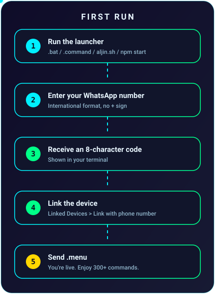

<a name="top"></a>

<div align="center">



# Al-Jin: Free Open-Source WhatsApp Bot

**Self-hosted WhatsApp Multi-Device bot on original Baileys v7 · nearly 400 commands · deploys with a single file**

Anti-delete · anti-edit · view-once saver · YouTube, movie, series and book downloaders · scheduling · group management · multi-session · Quran and Islamic search

<br/>

[](https://wa.me/923257853673?text=Hi%2C%20I%20need%20help%20with%20Al-Jin)
[](docs/README.md)
[](https://github.com/themalik-g/al-jin-lite)

[](https://github.com/themalik-g/al-jin-whatsapp-bot/releases)
[](LICENSE)
[](https://nodejs.org)
[](https://github.com/WhiskeySockets/Baileys)
[](https://github.com/themalik-g/al-jin-whatsapp-bot/stargazers)
[](https://github.com/themalik-g/al-jin-whatsapp-bot/network/members)
[](https://github.com/themalik-g/al-jin-whatsapp-bot/issues)

<br/>

**[Deployment](#deployment)** &nbsp;•&nbsp;
**[What makes it different](#what-makes-al-jin-different)** &nbsp;•&nbsp;
**[Features](#features-at-a-glance)** &nbsp;•&nbsp;
**[Documentation](#documentation)** &nbsp;•&nbsp;
**[FAQ](#faq)** &nbsp;•&nbsp;
**[Support](#support)**

</div>

<div align="center"></div>

## Overview

**Al-Jin** is a free, open-source **WhatsApp bot** for Node.js 20+, built on the **original [Baileys](https://github.com/WhiskeySockets/Baileys) `v7.0.0-rc.14`**, with no custom fork. It links to your account through **Linked Devices** with an 8-character pairing code (no QR scan) and runs on your own VPS, PC, phone or hosting panel. It ships with nearly 400 commands: media downloaders, message recovery, scheduling, group moderation, free AI chat, stickers, movies, books and Islamic tools.

Its main strength is how easy it is to deploy: **one file, one command, one pairing code**, on every platform.

> [!IMPORTANT]
> Al-Jin is an unofficial project and is not affiliated with or endorsed by WhatsApp or Meta. Automating a personal account can violate WhatsApp's Terms of Service and may lead to restrictions. Use accounts you can afford to risk, and only with the consent of the people you chat with.

<div align="center"></div>

<a name="deployment"></a>
## Deployment

Every method ends the same way: the bot prints an **8-character pairing code**, you enter it in WhatsApp, and you are online. Your session is saved, so later restarts need no new code.

### The universal method (VPS, panel, Windows, macOS, Linux; Bun also supported)

Only `index.js` is needed. On first start it downloads the rest of the bot and installs the dependencies by itself. Requires Node.js 20 or newer, or [Bun](#choose-your-platform) (the [one-click launchers](#windows-macos-and-linux-one-click) below install what is missing). Start with `node index.js` or `bun index.js`.

<div align="center">
  
</div>

| Step | What to do |
|:---:|---|
| **1** | **Download [`index.js`](https://raw.githubusercontent.com/themalik-g/al-jin-whatsapp-bot/main/index.js)** and upload it to your server or folder. Make sure it is named exactly `index.js` (browsers sometimes rename it to `index (1).js`). |
| **2** | **Number (optional on interactive terminals):** open `index.js` and put your number in `const BOT_NUMBER = '923001234567';` (digits only, with country code). If you leave it empty, the terminal asks you for it. **If your panel has no keyboard or console input (non-interactive), you must set it here**; you can also pass `--phone=923001234567`. |
| **3** | **Start:** `node index.js` (or `bun index.js` on a Bun server) |
| **4** | **Copy the pairing code** shown in the console. |
| **5** | **Link it:** WhatsApp → **Settings → Linked devices → Link a device → Link with phone number instead**, then enter the code. |
| **6** | Send **`.menu`** to the bot. |

Keep it running 24/7 with PM2: `pm2 start index.js --name al-jin && pm2 save && pm2 startup`.

### Choose your platform

<table>
<tr>
<td width="140"><b>🖥️ VPS / Linux server</b><br/><sub>recommended</sub></td>
<td>

```bash
apt update && apt install -y curl git ffmpeg
curl -fsSL https://deb.nodesource.com/setup_22.x | bash - && apt install -y nodejs
npm install -g pm2
mkdir -p ~/al-jin && cd ~/al-jin
curl -L -o index.js https://raw.githubusercontent.com/themalik-g/al-jin-whatsapp-bot/main/index.js
nano index.js          # optional: set BOT_NUMBER = '923001234567'
node index.js          # copy the pairing code, link it in WhatsApp, then Ctrl+C
pm2 start index.js --name al-jin && pm2 save && pm2 startup
```

Or upload `index.js` with FileZilla, WinSCP or `scp` instead of `curl`. 1 vCPU and 1 GB RAM is enough. Full guide: [VPS section](docs/whatsapp-bot-deployment.md#3-vps--linux-server-recommended).
</td>
</tr>
<tr>
<td><b>🧩 Bot panels</b><br/><sub>Pterodactyl, bot-hosting, etc.</sub></td>
<td>

1. Create a **Node.js 20+** server (512 MB RAM minimum, 1 GB better).
2. Upload `index.js` in the File Manager.
3. **Edit `BOT_NUMBER` in `index.js`.** Panels are non-interactive, so this step is required.
4. Set the startup command to `node index.js` and press **Start**.
5. Copy the pairing code from the console and link it in WhatsApp.

Details and thread-limit fixes: [Panel guide](docs/whatsapp-bot-deployment.md#5-pterodactyl--bot-hosting-panels).
</td>
</tr>
<tr>
<td><b>🪟 Windows, 🍎 macOS, 🐧 Linux</b><br/><sub>one-click</sub></td>
<td>

<a name="windows-macos-and-linux-one-click"></a>

- **Windows:** download `Al-Jin-Start.bat`, double-click, type your number, enter the code.
- **macOS:** double-click `Al-Jin-Start.command`.
- **Linux:** `bash aljin.sh`

No Node.js, npm or git needed beforehand. Already have Node 20+? The universal method above works the same on Windows, macOS and Linux. To start again after a restart, open the same file; no new code is needed. Guide: [One-click start](docs/one-click-deploy.md).
</td>
</tr>
<tr>
<td><b>⚡ Bun server</b><br/><sub>panel or VPS</sub></td>
<td>

Same as Node.js: **upload `index.js` and start it.** `index.js` detects Bun and installs and runs everything with Bun itself, so Node.js and npm are not needed.

1. Upload `index.js` (and set `BOT_NUMBER` in it if the panel is non-interactive).
2. Set the startup command to `bun index.js` (or run `bun index.js` in a terminal).
3. Copy the pairing code from the console and link it in WhatsApp.

No Bun on your machine yet? One command installs it and starts the bot: `curl -fsSL -o aljin-bun.sh https://raw.githubusercontent.com/themalik-g/al-jin-whatsapp-bot/main/aljin-bun.sh && bash aljin-bun.sh`. Guide: [Bun support](docs/bun-launcher.md).
</td>
</tr>
<tr>
<td><b>📱 Android</b><br/><sub>Termux</sub></td>
<td>

```bash
pkg install -y curl && curl -fsSL -o aljin.sh https://raw.githubusercontent.com/themalik-g/al-jin-whatsapp-bot/main/aljin.sh && bash aljin.sh
```

Guide: [Termux](docs/one-click-deploy.md#android-phone-termux).
</td>
</tr>
<tr>
<td><b>🐳 Docker, ☁️ cloud</b></td>
<td>Docker, Docker Compose, Koyeb, Railway, Render and Fly.io: <a href="docs/whatsapp-bot-deployment.md">Deployment guide</a>.</td>
</tr>
<tr>
<td><b>🪶 Only 256 MB RAM?</b></td>
<td>Use <a href="https://github.com/themalik-g/al-jin-lite"><b>Al-Jin Lite</b></a> on any free host (Katabump and similar). See <a href="docs/lite-and-hosting.md">Lite and hosting options</a>.</td>
</tr>
</table>

> [!NOTE]
> The WhatsApp session lives in the `instances/` folder. On any host that wipes its disk on restart, keep that folder on persistent storage or the bot logs out each time.

### Low RAM, small disks and adjustable limits

RAM, disk and download limits adapt to your server. Set them live from WhatsApp as owner:

`.ramlimit 512 restart` · `.cpulimit` · `.dlcap 500mb` · `.dlcap quality 480` · `.ram` · `.rom` · `.disk`

Details: [Lite and hosting options](docs/lite-and-hosting.md) · [Settings and keys](docs/settings-and-keys.md).

### Free self-deployment support, and hosting if you need it

Stuck while deploying? Message the developer on WhatsApp. Support is free and needs no premium plan. If you cannot pay for a server because of payment-method restrictions or similar, managed hosting is available from the owner on request. It is a courtesy, not a business.

[](https://wa.me/923257853673?text=Hi%2C%20I%20need%20help%20with%20Al-Jin)

<div align="center"></div>

## What makes Al-Jin different

| | |
|---|---|
| **⬇️ YouTube downloads that keep working** | Several integrated download engines. If one fails, the next is tried automatically. |
| **🕵️ Anti-delete and anti-edit** | See what people deleted or edited: text, images, video, documents, voice notes. |
| **👁️ View-once saver** | Reply to a view-once photo or video and the real media lands in the owner's DM. Optional auto-save. |
| **🖼️ Full-size profile pictures** | `.getpp` fetches the full-resolution picture of any user or group. |
| **📚 Dedicated book engine** | `.book` finds and sends free books ([details](docs/book-downloader.md)). |
| **🎬 Dedicated movie and series engine** | Seasons, episodes, paging and quality choice ([details](docs/whatsapp-movie-series-downloader.md)). |
| **🕌 Quran and Islamic search** | Verse lookup, AI and keyword search, hadith, plus full **Surah** and **Juz/Para** PDF downloads ([details](docs/islamic-tools.md)). |
| **⏰ Full scheduling** | Schedule text or media to groups, channels and private chats. |
| **👥 Complete group management** | Moderation, anti-link, anti-spam, warnings, welcome messages, bulk tools. |
| **🔀 Flawless multi-session** | Run several WhatsApp numbers from one install. |
| **💬 Three reply modes** | Selection prompts as text, poll or buttons: `.replymode text\|poll\|buttons`. |
| **🔒 Original Baileys v7.0.0-rc.14** | No custom fork, so you stay on the upstream security and protocol fixes. |
| **📖 Built-in manual** | Guide and details of every feature through a WhatsApp list: send `.menu`, or `.usermanual` for the PDF. |
| **🆓 Fully open source** | MIT licence. No paid tiers, no subscriptions. |

<div align="center"></div>

## Features at a glance

| Area | Highlights | More |
|---|---|---|
| Message recovery | Ghost (anti-delete, anti-edit), Peek (view-once), Lurk (status saver) | [Features](docs/features.md) |
| Downloaders | YouTube, Instagram, TikTok, Facebook, X, Pinterest, Threads, Reddit, GitHub, MediaFire | [Features](docs/features.md#universal-downloader) |
| Movies, series, books | `.movie` `.series` `.continue` `.book` | [Movies](docs/whatsapp-movie-series-downloader.md) · [Books](docs/book-downloader.md) |
| Islamic tools | `.quran` `.sora` `.para` `.islamsearch` `.bukhari` `.muslim` `.prayertimes` | [Islamic tools](docs/islamic-tools.md) |
| Scheduling | `.schedule` for groups, channels and chats, including group open/close | [Features](docs/features.md#scheduling) |
| Group admin | `.kick` `.promote` `.tagall` `.antilink` `.antispam` `.warn` `.gshield` | [Features](docs/features.md#group-management) |
| AI and documents | `.jin` `.bot` `.gemini` `.ppt` `.ocr` `.tts` `.subtitle` | [Features](docs/features.md#ai-speech-and-documents) |
| Stickers and media | `.sticker` `.toimg` `.tomp3` `.textmaker` and more | [Features](docs/features.md#stickers-media-and-fun) |
| Stealth by default | Appears quiet until you switch behaviours on | [Stealth](docs/stealth.md) |

The bot runs without any API key. Optional free keys (Groq, Gemini and others) only make AI and speech faster: [Settings and keys](docs/settings-and-keys.md).

<div align="center"></div>

<a name="documentation"></a>
## Documentation

Everything beyond this page lives in [`docs/`](docs/README.md).

| Topic | Guides |
|---|---|
| 🚀 Getting started | [One-click start](docs/one-click-deploy.md) · [Manual install](docs/manual-install.md) · [Deployment](docs/whatsapp-bot-deployment.md) · [Lite and hosting](docs/lite-and-hosting.md) · [Bun support](docs/bun-launcher.md) |
| 🎮 Using the bot | [Features](docs/features.md) · [Commands](docs/whatsapp-bot-commands.md) · [Categories](docs/command-categories.md) · [Stealth](docs/stealth.md) · [Settings and keys](docs/settings-and-keys.md) · [Configuration](docs/whatsapp-bot-configuration.md) |
| 🎬 Dedicated engines | [Movies and series](docs/whatsapp-movie-series-downloader.md) · [Books](docs/book-downloader.md) · [Islamic tools](docs/islamic-tools.md) · [Subtitles](docs/subtitles.md) · [PowerPoint](docs/presentations.md) |
| 🔧 Help | [Troubleshooting](docs/whatsapp-bot-troubleshooting.md) · [FAQ](docs/faq.md) · [Support](docs/support.md) |
| 🏗️ Reference | [Project structure](docs/project-structure.md) · [Architecture](docs/whatsapp-bot-architecture.md) · [JID system](docs/whatsapp-jid-system.md) · [Changelog](docs/changelog/README.md) · [Al-Jin vs other bots](docs/al-jin-vs-other-whatsapp-bots.md) |
| 🤝 Project | [Contributing](docs/contributing.md) · [MIT License](LICENSE) |

<div align="center"></div>

## Why choose Al-Jin

| | Al-Jin | Typical cloud bot | Other self-hosted bots |
|---|:---:|:---:|:---:|
| Price | Free | Monthly fee | Free |
| Data location | Your device | Provider's cloud | Your device |
| Deployment | One file, one command | Sign-up and dashboard | Usually manual |
| Baileys | Original v7.0.0-rc.14 | n/a | Often a custom fork |
| Anti-delete / anti-edit | Built in | Often paid | Varies |
| View-once saver | Built in | Rare | Varies |
| Downloader fallbacks | Multiple engines | Single | Varies |
| Free AI chat | Built in | Limited | Varies |

Detailed comparison: [Al-Jin vs other WhatsApp bots](docs/al-jin-vs-other-whatsapp-bots.md).

<div align="center"></div>

<a name="faq"></a>
## FAQ

<details>
<summary><b>Is Al-Jin free and open source?</b></summary>

<br/>

Yes. It is released under the MIT License with no paid tiers. Optional services you connect yourself (such as an API key) follow their own pricing.

</details>

<details>
<summary><b>How do I deploy a WhatsApp bot on a VPS?</b></summary>

<br/>

Download `index.js`, upload it to the server, optionally set your number in it, run `node index.js`, then enter the pairing code under Linked Devices in WhatsApp. See [Deployment](#deployment).

</details>

<details>
<summary><b>Do I need a QR code?</b></summary>

<br/>

No. Al-Jin uses an 8-character pairing code. Enter it in WhatsApp under **Linked devices → Link with phone number instead**.

</details>

<details>
<summary><b>Is it safe? Can my number get banned?</b></summary>

<br/>

Your data stays on your own device. However, Al-Jin is an unofficial client, and WhatsApp can restrict accounts that use automation. Avoid bulk messaging or spam, and consider a secondary number.

</details>

<details>
<summary><b>Does it work with WhatsApp Business?</b></summary>

<br/>

Yes, through Linked Devices on both WhatsApp Messenger and WhatsApp Business.

</details>

<details>
<summary><b>Can I run more than one WhatsApp number?</b></summary>

<br/>

Yes. Owners add sessions with `.addsession` and remove them with `.delsession`. Each session keeps its own data inside `instances/`.

</details>

<details>
<summary><b>Can I run it on a very small server?</b></summary>

<br/>

Yes. Cap RAM and downloads with `.ramlimit` and `.dlcap`, or use [Al-Jin Lite](https://github.com/themalik-g/al-jin-lite) on hosts with 256 MB of RAM.

</details>

More answers: [FAQ](docs/faq.md) · [Troubleshooting](docs/whatsapp-bot-troubleshooting.md).

<div align="center"></div>

<a name="support"></a>
## Support

- **WhatsApp:** message **@insaf.pk** with a screenshot of the error. Free, no premium needed.
- **GitHub:** [report a bug](https://github.com/themalik-g/al-jin-whatsapp-bot/issues/new?labels=bug) or [request a feature](https://github.com/themalik-g/al-jin-whatsapp-bot/issues/new?labels=enhancement).

[](https://wa.me/923257853673?text=Hi%2C%20I%20need%20help%20with%20Al-Jin)

## License and contributing

Released under the [MIT License](LICENSE). Copyright (c) 2026 MALIK. Contributions are welcome: see [Contributing](docs/contributing.md) and the [project structure](docs/project-structure.md).

<details>
<summary>Search keywords</summary>

<br/>

WhatsApp bot, WhatsApp bot Node.js, WhatsApp multi-device bot, Baileys v7 bot, open source WhatsApp bot, self-hosted WhatsApp bot, WhatsApp bot pairing code, WhatsApp anti-delete bot, WhatsApp view once saver, WhatsApp status saver, WhatsApp YouTube downloader bot, WhatsApp movie downloader bot, WhatsApp book downloader, WhatsApp group management bot, WhatsApp message scheduler, WhatsApp Quran bot, WhatsApp bot VPS deploy, Termux WhatsApp bot, Pterodactyl WhatsApp bot, Al-Jin MD.

</details>

<div align="center">


**Built by [Malik Mehtab](https://github.com/themalik-g)** &nbsp;|&nbsp; [⬆ Back to top](#top)

</div>
