# Project structure

The real file tree of the repository, moved here from the main README to keep it short.

[← Back to the README](../README.md) · [All docs](./README.md)

The `runtime` folders (`instances/`, `vault/`) are created on first run and are git-ignored.

## Tech stack

Node.js 20+ (ESM) · [Baileys](https://github.com/WhiskeySockets/Baileys) `7.0.0-rc.14` (original, unforked) · FFmpeg · yt-dlp · Tesseract.js · PptxGenJS · PM2 · Docker.

## Diagram

```mermaid
flowchart LR
    ROOT["📁 al-jin-whatsapp-bot/"]
    TOP["📄 Root files<br/>index.js<br/>start.js<br/>router.js<br/>config.js<br/>noaction.js<br/>dp.mjs<br/>Al-Jin-Start.bat<br/>Al-Jin-Start.command<br/>aljin.sh<br/>Dockerfile<br/>Procfile<br/>ecosystem.config.cjs<br/>keys.env.example<br/>llms.txt<br/>package.json<br/>README.md<br/>LICENSE"]
    CORE["📁 core/<br/><i>runtime: env, identity, limiter, vault</i>"]
    COREF1["bootstrap-env.js<br/>groupEvents.js<br/>identity.js<br/>jid-resolver.js<br/>keys.js<br/>limiter.js<br/>limits.js<br/>paths.js"]
    COREF2["session-repair.js<br/>settings.js<br/>state-io.js<br/>status-store.js<br/>vars.js<br/>vault.js"]
    MODS["📁 modules/<br/><i>command modules</i>"]
    MODSF1["activity.js<br/>admin.js<br/>apk.js<br/>bundle2.js<br/>debug.js<br/>details.js<br/>devices.js<br/>disappearing.js<br/>disk.js<br/>dlcap.js"]
    MODSF2["download.js<br/>downloader.js<br/>esm-commands.js<br/>fb.js<br/>fetch.js<br/>forward.js<br/>fun.js<br/>gemini.js<br/>ghost.js<br/>group.js"]
    MODSF3["help.js<br/>igplus.js<br/>islamic.js<br/>jid.js<br/>jin.js<br/>limits.js<br/>location.js<br/>logger.js<br/>lurk.js<br/>media-tools.js"]
    MODSF4["media.js<br/>network-tools.js<br/>noaction.js<br/>owner.js<br/>peek.js<br/>pin.js<br/>ping.js<br/>pps.js<br/>ppt.js<br/>prefix.js"]
    MODSF5["presence-track.js<br/>presence.js<br/>profile.js<br/>schedule.js<br/>settings-cmd.js<br/>social.js<br/>spy.js<br/>stickers.js<br/>textmaker.js<br/>theme.js"]
    MODSF6["tools.js<br/>update.js<br/>url.js<br/>usermanual.js<br/>utility.js<br/>x-anim.js<br/>x-audio.js<br/>x-bot.js<br/>x-chatbot.js<br/>x-details.js"]
    MODSF7["x-effects.js<br/>x-fun.js<br/>x-group.js<br/>x-guard.js<br/>x-hooks.js<br/>x-media.js<br/>x-movie.js<br/>x-music.js<br/>x-react.js<br/>x-registry.js"]
    MODSF8["x-remini.js<br/>x-repair.js<br/>x-subtitle.js<br/>x-tdl.js<br/>x-tgsticker.js<br/>x-tools.js<br/>x-web.js<br/>ytcookies.js<br/>ytdlp-commands.js"]
    LIB["📁 lib/<br/><i>helpers: yt-dlp, FFmpeg, LLM, subtitles, movies</i>"]
    LIBF1["ai.js<br/>apis.js<br/>audio-effects.js<br/>buttons.js<br/>ephoto360.js<br/>esm-secrets.js<br/>esm.js<br/>fakequote.js<br/>ffmpeg-resolver.js<br/>guard-core.js"]
    LIBF2["ia-movies.js<br/>image-resize.js<br/>llm.js<br/>m3u8.js<br/>moviebox.js<br/>net.js<br/>own-warmup.js<br/>pdf.js<br/>poll.js<br/>progress.js"]
    LIBF3["reaction-helper.js<br/>stream-send.js<br/>stt.js<br/>subtitle-args.js<br/>subtitle-render.js<br/>subtitle-translate.js<br/>sysinfo.js<br/>targets.js<br/>title-resolver.js<br/>uploadImage.js"]
    LIBF4["video-converter.js<br/>webp-anim.js<br/>webp-exif.js<br/>x.js<br/>ytdlp.js<br/>ytsearch.js<br/>zipstream.js<br/>ppt/ (generator, renderer, schema)"]
    SCR["📁 scripts/<br/><i>postinstall</i>"]
    SCRF1["apply-baileys-patch.js"]
    PAT["📁 patches/<br/><i>Baileys rc14 fix</i>"]
    PATF1["decode-wa-message.js"]
    ST["📁 state/<br/><i>small JSON state</i>"]
    STF1["ghost-ledger.json<br/>ghost.json<br/>lurk.json<br/>owner.json<br/>peek.json"]
    FN["📁 fonts/<br/><i>sticker and text fonts</i>"]
    FNF1["Caladea-Bold.ttf<br/>Carlito-Bold.ttf<br/>DejaVuSans-Bold.ttf<br/>DejaVuSansCondensed-Bold.ttf<br/>LiberationMono-Bold.ttf<br/>LiberationSans-Bold.ttf<br/>LiberationSerif-Bold.ttf<br/>Poppins-Bold.ttf"]
    TST["📁 test/<br/><i>test files</i>"]
    TSTF1["book.test.js<br/>buttons.test.js<br/>disappearing.test.js<br/>esm-commands.test.js<br/>fetch.test.js<br/>ffmpeg-resolver.test.js<br/>islamic.test.js<br/>lid-resolver.test.js<br/>logger.test.js"]
    TSTF2["moviebox-m3u8.test.js<br/>movies.test.js<br/>new-commands.test.js<br/>ocr.test.js<br/>ppt-ondemand.test.js<br/>reaction-helper.test.js<br/>subtitle.test.js<br/>video-converter.test.js<br/>x-extras.test.js"]
    TSTF3["x-guard.test.js"]
    DOCS["📁 docs/<br/><i>guides and reference</i>"]
    DOCSF1["README.md<br/>al-jin-vs-other-whatsapp-bots.md<br/>command-categories.md<br/>faq.md<br/>manual-install.md<br/>one-click-deploy.md<br/>presentations.md<br/>settings-and-keys.md<br/>stealth.md<br/>subtitles.md"]
    DOCSF2["support.md<br/>whatsapp-bot-architecture.md<br/>whatsapp-bot-commands.md<br/>whatsapp-bot-configuration.md<br/>whatsapp-bot-deployment.md<br/>whatsapp-bot-troubleshooting.md<br/>whatsapp-jid-system.md<br/>whatsapp-movie-series-downloader.md<br/>changelog/"]
    ASS["📁 assets/<br/><i>banner, diagrams, gif</i>"]
    ASSF1["al-jin-whatsapp-bot.gif<br/>architecture.svg<br/>banner.svg<br/>divider.svg<br/>file-tree.svg<br/>footer.svg<br/>setup-flow.svg"]
    ASSF2["terminal.svg"]

    ROOT --> TOP
    ROOT --> CORE
    CORE --> COREF1
    CORE --> COREF2
    ROOT --> MODS
    MODS --> MODSF1
    MODS --> MODSF2
    MODS --> MODSF3
    MODS --> MODSF4
    MODS --> MODSF5
    MODS --> MODSF6
    MODS --> MODSF7
    MODS --> MODSF8
    ROOT --> LIB
    LIB --> LIBF1
    LIB --> LIBF2
    LIB --> LIBF3
    LIB --> LIBF4
    ROOT --> SCR
    SCR --> SCRF1
    ROOT --> PAT
    PAT --> PATF1
    ROOT --> ST
    ST --> STF1
    ROOT --> FN
    FN --> FNF1
    ROOT --> TST
    TST --> TSTF1
    TST --> TSTF2
    TST --> TSTF3
    ROOT --> DOCS
    DOCS --> DOCSF1
    DOCS --> DOCSF2
    ROOT --> ASS
    ASS --> ASSF1
    ASS --> ASSF2

    classDef root fill:#0f0c29,stroke:#00f0ff,stroke-width:2px,color:#e8f6ff
    classDef dir fill:#14183a,stroke:#a78bfa,stroke-width:2px,color:#e8f6ff
    classDef file fill:#0b1026,stroke:#25d366,color:#e8f6ff,text-align:left
    class ROOT root
    class CORE,MODS,LIB,SCR,PAT,ST,FN,TST,DOCS,ASS dir
    class TOP,COREF1,COREF2,MODSF1,MODSF2,MODSF3,MODSF4,MODSF5,MODSF6,MODSF7,MODSF8,LIBF1,LIBF2,LIBF3,LIBF4,SCRF1,PATF1,STF1,FNF1,TSTF1,TSTF2,TSTF3,DOCSF1,DOCSF2,ASSF1,ASSF2 file
```



## Copy-friendly text tree

```text
al-jin-whatsapp-bot/
├── index.js                 # Launcher: asks for your number, pairs, supervises start.js
├── start.js                 # Per-session worker: Baileys socket, events, scheduler
├── router.js                # Command router (cold commands load lazily)
├── config.js                # Owner number, codename, reconnect settings
├── noaction.js              # No-action helpers
├── dp.mjs                   # Profile picture tool
├── core/                    # Runtime: env, identity, JID resolver, limiter, vault, settings
├── modules/                 # 79 command modules (ghost, peek, lurk, download, group, ppt ...)
├── lib/                     # 43 helpers (yt-dlp, FFmpeg, LLM, subtitles, movies, ppt/ ...)
├── scripts/                 # apply-baileys-patch.js (runs on postinstall)
├── patches/                 # Baileys rc14 decrypt fix
├── state/                   # Small JSON state (ghost ledger, lurk, peek, owner)
├── fonts/                   # Fonts for stickers and text effects
├── test/                    # 19 test files
├── docs/                    # Guides, command reference, troubleshooting
├── Al-Jin-Start.bat         # Windows launcher
├── Al-Jin-Start.command     # macOS launcher
├── aljin.sh                 # Linux / macOS / Termux installer
├── Dockerfile               # Node 20 image, session volume at /app/instances
├── Procfile                 # worker: node index.js
├── ecosystem.config.cjs     # PM2 production config
├── .env.example             # Launcher variables
├── keys.env.example         # Optional API keys
├── llms.txt                 # Machine-readable project summary
└── package.json
```

> [!CAUTION]
> `instances/` holds your WhatsApp login, and `.env` / `keys.env` hold your keys. They are git-ignored; never commit, upload or share them (including inside zip files).
